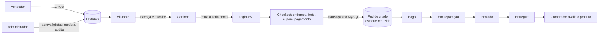

<p align="center">
  
</p>

<p align="center"><strong>Achados que brilham, de lojas independentes de todo o Brasil.</strong></p>

# Âmbar Marketplace

> **Status:** Entrega 2 — banco de dados, cadastro, login, JWT e controle de acesso.

O Âmbar é um marketplace web que reúne pequenas lojas independentes (ateliês, marcas autorais, lojas de bairro e produtores locais) em uma vitrine única, com estoque controlado automaticamente, pedidos rastreáveis e compra segura.

## 1. O problema

Pequenos negócios já vendem pela internet, mas vendem mal. Segundo levantamento do Sebrae com a E-Commerce Brasil, **73% dos pequenos negócios já vendem por canais digitais**, porém **78,8% trabalham com apenas um ou dois canais** e só **28,1% usam marketplaces**. Nos grandes marketplaces, as **taxas variam de 5,99% a 30%** por venda, além de frete e anúncios pagos ([O Hoje, 27/09/2026](https://ohoje.com/2026/09/27/marketplaces-ampliam-vendas-de-pequenos-negocios-mas-pressionam-margem/)).

Na prática, a maioria dessas lojas vende por redes sociais e mensagens, com controle manual:

- **Estoque em planilha ou de memória** — a mesma peça é vendida duas vezes e o cliente descobre depois.
- **Pedidos espalhados em conversas** — sem status, sem histórico e sem rastreio.
- **Pouca confiança do comprador** — não há avaliações verificadas nem uma política clara de entrega e cancelamento.
- **Invisibilidade** — nos grandes marketplaces, a loja pequena some entre milhões de anúncios e paga caro por isso.

### Público afetado

| Público | Como o problema aparece |
| --- | --- |
| Pequenos lojistas e criadores independentes | Perdem vendas por erro de estoque, gastam tempo respondendo pedidos manualmente e pagam comissões altas. |
| Consumidores | Querem comprar de marcas independentes, mas não têm garantia de entrega, histórico do pedido nem avaliações confiáveis. |
| Curadoria da plataforma | Precisa aprovar lojistas, moderar conteúdo e acompanhar vendas com segurança. |

## 2. Proposta de solução

Uma plataforma em que **cada lojista tem sua vitrine** dentro de um marketplace curado. O sistema cuida do que hoje é feito à mão:

- o estoque baixa sozinho, dentro de uma transação, no momento da compra — nunca é vendido o que não existe;
- cada pedido tem um status claro (aguardando pagamento → pago → em separação → enviado → entregue) e um histórico;
- só quem comprou e recebeu o produto pode avaliá-lo (compra verificada);
- a administração aprova novos lojistas, modera avaliações e acompanha um registro de auditoria.

### Objetivos

1. Dar a pequenos lojistas uma loja online organizada, sem exigir conhecimento técnico.
2. Garantir ao comprador preço, estoque e status de pedido sempre corretos.
3. Oferecer à administração controle e rastreabilidade de tudo o que acontece na plataforma.

## 3. Principais funcionalidades previstas

- Cadastro, login e três perfis de acesso com JWT.
- Catálogo público com busca, filtros (categoria, preço, avaliação, desconto, frete grátis) e ordenação.
- Página de produto com galeria, avaliações, perguntas e respostas e produtos relacionados.
- Carrinho, cálculo de frete por CEP, cupons de desconto e checkout com Pix, cartão ou boleto (pagamento simulado).
- Pedidos com status, histórico, rastreio e cancelamento com devolução automática do estoque.
- Vitrine própria para cada loja.
- Painel do vendedor: produtos (CRUD), estoque, vendas e perguntas de clientes.
- Painel administrativo: indicadores, pedidos, produtos, categorias, usuários, lojas, cupons, banners, avaliações, auditoria e configurações.
- Segurança: senhas com bcrypt, bloqueio após tentativas de login, limite de requisições, cabeçalhos de segurança e permissões verificadas na API.

## 4. Tipos de usuário

| Perfil | O que pode fazer |
| --- | --- |
| **Visitante** | Navegar pelo catálogo, buscar, ver produtos e lojas, montar o carrinho e criar uma conta. |
| **Comprador** | Tudo do visitante, mais: finalizar compras, acompanhar e cancelar pedidos, avaliar produtos recebidos, fazer perguntas, favoritar, gerenciar endereços e pedir para virar vendedor. |
| **Vendedor** | Gerenciar os próprios produtos e estoque, ver as vendas da sua loja, responder perguntas e atualizar o envio dos pedidos da loja. |
| **Administrador** | Gerenciar todo o sistema: usuários e níveis, aprovação de lojistas, categorias, produtos de qualquer loja, pedidos, cupons, banners, moderação de avaliações, auditoria e configurações. |

## 5. Fluxo básico



1. O visitante navega pelo catálogo e adiciona produtos ao carrinho.
2. Para finalizar, entra na conta (ou se cadastra como comprador).
3. No checkout escolhe endereço, frete, cupom e forma de pagamento.
4. A API confere preços e estoque no banco, cria o pedido e baixa o estoque em uma única transação.
5. O pedido avança de status pelo vendedor ou pela administração; ao ser entregue, o comprador pode avaliar.

## 6. Tecnologias previstas

- **Front-end:** HTML5, CSS3 e JavaScript puro (DOM + Fetch API).
- **Back-end:** Node.js, Express, `mysql2`, `jsonwebtoken`, `bcryptjs`, `helmet`, `cors` e `dotenv`.
- **Banco de dados:** MySQL 8.

## 7. Estrutura inicial

```text
ambar-marketplace/
├── backend/
│   ├── routes/        # liga métodos e URLs aos controllers
│   ├── controllers/   # recebe a requisição, valida e responde
│   ├── middlewares/   # autenticação, autorização, segurança e erros
│   ├── services/      # regras de negócio reutilizáveis (pedidos, frete, cupons)
│   ├── database/      # conexão com o MySQL
│   ├── utils/         # validações e funções de apoio
│   ├── config/        # leitura do .env
│   └── server.js
├── frontend/
│   ├── css/
│   ├── js/
│   └── assets/        # marca, fontes, fotos e sons
├── sql/               # scripts do banco de dados
├── docs/              # documentação de apoio
├── .gitignore
└── README.md
```

## 8. Planejamento das entregas

| Entrega | Foco | Situação |
| --- | --- | --- |
| 1 | Problema, proposta e estrutura inicial. | Concluída |
| 2 | Banco de dados relacional, cadastro, login, JWT e controle de acesso. | Concluída |
| 3 | CRUDs completos integrados ao front-end, permissões e regras de negócio. | Próxima |
| 4 | Sistema completo, testes, documentação final e apresentação. | — |

## 9. Banco de dados

MySQL 8 com 19 tabelas relacionadas. O modelo completo, o diagrama entidade-relacionamento e as decisões de modelagem estão em [`docs/banco-de-dados.md`](docs/banco-de-dados.md).

- `sql/01_estrutura.sql` — cria o banco `ambar_marketplace`, tabelas, chaves primárias, estrangeiras, `UNIQUE` e `CHECK`.
- `sql/02_dados_demo.sql` — contas, 11 lojas, 69 produtos, 123 pedidos, avaliações e perguntas de demonstração.

## 10. Autenticação e controle de acesso

```text
Cadastro/Login → bcrypt confere a senha → API assina o JWT → navegador envia "Authorization: Bearer <token>"
→ middleware autenticar (assinatura, validade, usuário ativo, versão do token) → middleware autorizar(níveis) → rota
```

- **Senhas** protegidas com `bcrypt` (custo 12). A senha precisa de 8+ caracteres com maiúscula, minúscula e número.
- **JWT** (`HS256`) com `sub`, `nivel` e `ver`, emissor e público próprios e expiração de 2 horas. O segredo fica só no `.env`.
- **Nível sempre atual**: a cada requisição o usuário é buscado no banco. Bloquear a conta, trocar a senha ou "sair de todos os dispositivos" invalida tokens antigos na hora (`token_versao`).
- **Bloqueio por tentativas**: 5 senhas erradas seguidas pausam o acesso daquela conta por 15 minutos; o IP também tem limite de tentativas.
- **Sem pistas para robôs**: o login responde igual para e-mail inexistente e senha errada, inclusive no tempo de resposta.
- **Cabeçalhos de segurança** com `helmet` (Content-Security-Policy, X-Frame-Options, Referrer-Policy) e CORS restrito.
- **Auditoria**: logins, falhas, bloqueios e trocas de senha ficam em `logs_auditoria`.

### Rotas desta entrega

| Método e rota | Acesso | Descrição |
| --- | --- | --- |
| `POST /api/auth/cadastro` | Público | Cria uma conta de comprador e já devolve o token. |
| `POST /api/auth/login` | Público | Confere as credenciais e devolve `{ token, usuario }`. |
| `GET /api/auth/eu` | Autenticado | Dados atuais do usuário e resumo (pedidos, favoritos, endereços). |
| `PUT /api/auth/perfil` | Autenticado | Atualiza nome e telefone. |
| `PUT /api/auth/senha` | Autenticado | Troca a senha (exige a atual) e encerra outras sessões. |
| `POST /api/auth/sair-de-todos` | Autenticado | Invalida todos os tokens emitidos para a conta. |
| `GET /api/saude` | Público | Verifica se a API e o banco estão no ar. |

## 11. Como executar (até esta entrega)

Pré-requisitos: Node.js 20+ e MySQL 8.0.16+.

```bash
cd backend
npm install
cp .env.example .env        # no Windows: copy .env.example .env
```

Preencha o `.env` (usuário e senha do MySQL e um `JWT_SECRET` com 32+ caracteres; gere um com `node -e "console.log(require('node:crypto').randomBytes(48).toString('hex'))"`). Se a senha do MySQL tiver `#`, coloque-a entre aspas: `DB_PASSWORD="minha#senha"`.

```bash
npm run db:criar            # executa sql/01_estrutura.sql e sql/02_dados_demo.sql
npm start                   # http://localhost:3000
```

Também é possível rodar os dois arquivos da pasta `sql/` no MySQL Workbench, na ordem.

### Contas de demonstração

Todas usam a senha `Ambar@2026`.

| Perfil | E-mail |
| --- | --- |
| Administrador | `admin@ambar.test` |
| Vendedor (Ateliê Jacarandá) | `vendedor@ambar.test` |
| Comprador | `comprador@ambar.test` |
