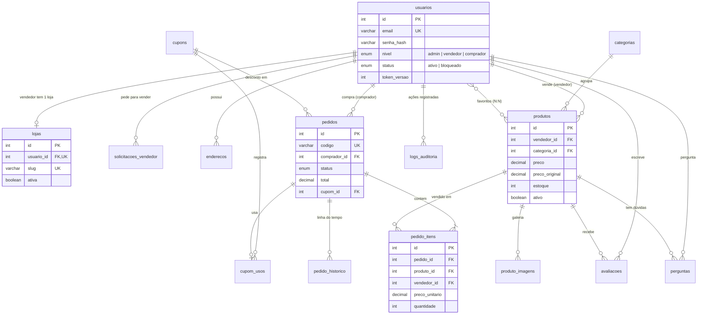

# Banco de dados — Âmbar Marketplace

MySQL 8 com InnoDB (transações e chaves estrangeiras). Os scripts ficam em `sql/`:

| Arquivo | Conteúdo |
| --- | --- |
| `01_estrutura.sql` | Recria o banco `ambar_marketplace` com todas as tabelas, chaves e restrições. |
| `02_dados_demo.sql` | Dados de demonstração: contas, lojas, produtos, pedidos, avaliações e perguntas. |

## Diagrama entidade-relacionamento

## Tabelas

| Tabela | Papel | Destaques |
| --- | --- | --- |
| `usuarios` | Contas de todos os perfis | `email` único, `senha_hash` (bcrypt), `nivel`, `status`, contador de tentativas e `token_versao` para revogar JWT. |
| `lojas` | Vitrine de cada vendedor | 1:1 com `usuarios` (`usuario_id` único); `ativa` suspende a loja inteira. |
| `solicitacoes_vendedor` | Pedidos para virar lojista | Status `pendente`, `aprovada` ou `recusada`, com quem avaliou e quando. |
| `enderecos` | Endereços de entrega | CEP validado por `CHECK`; `ON DELETE CASCADE` com o usuário. |
| `categorias` | Organização do catálogo | `slug` único para URLs amigáveis. |
| `produtos` | Itens à venda | Preço positivo, `preco_original` maior que o preço, exclusão lógica (`ativo`), média de avaliações e total vendido. |
| `produto_imagens` | Galeria | Várias fotos por produto, em ordem. |
| `cupons` | Descontos | Percentual (até 90%) ou valor fixo, mínimo do pedido, teto, limite de usos, período e regra de primeira compra. |
| `pedidos` | Compras | Código amigável único, valores congelados, endereço copiado, status e rastreio. |
| `pedido_itens` | Itens de cada pedido | Nome, imagem e preço do momento da compra; `UNIQUE (pedido_id, produto_id)`. |
| `pedido_historico` | Linha do tempo | Um registro por mudança de status. |
| `cupom_usos` | Uso de cupons | Garante "um uso por cliente" e permite devolver o uso ao cancelar. |
| `avaliacoes` | Notas de 1 a 5 | Uma por cliente e produto (`UNIQUE`), com moderação (`visivel`). |
| `perguntas` | Perguntas e respostas | Respondidas pelo vendedor do produto. |
| `favoritos` | Lista de desejos | Relação N:N com chave primária composta. |
| `banners` | Carrossel da página inicial | Imagem e vídeo opcionais. |
| `configuracoes` | Regras ajustáveis | Frete grátis, desconto do Pix, parcelas e avisos do topo. |
| `newsletter` | Inscrições | E-mail único. |
| `logs_auditoria` | Rastreabilidade | Quem fez o quê, quando e de qual IP (com detalhes em JSON). |

## Decisões de modelagem

- **Dinheiro em `DECIMAL`**: nunca `FLOAT`. A API soma em centavos (inteiros).
- **Exclusão lógica de produtos**: apagar de verdade quebraria as chaves estrangeiras de pedidos antigos.
- **Fotografia da venda**: `pedido_itens` guarda nome, imagem e preço; editar o produto depois não muda o histórico.
- **Endereço copiado para o pedido**: mudar o cadastro não altera para onde o pedido foi enviado.
- **`TIMESTAMP` em UTC**: datas consistentes entre o MySQL, a API e o navegador.
- **Restrições `CHECK`**: o próprio banco recusa preço negativo, nota fora de 1 a 5 e CEP inválido.

## Atualização: modelo de ofertas

A versão atual acrescenta `rodadas_ofertas` e `lances`, totalizando 21 tabelas. Cada produto pode ter várias rodadas; cada rodada recebe lances de compradores. A rodada aceita no máximo uma oferta e aponta para o pedido gerado. O pedido contém `oferta_id` único e chaves estrangeiras para preservar a consistência.

O preço de produto deixa de ser fixo: `produtos.preco` e `preco_original` são nulos e protegidos por CHECK. O valor acordado é copiado de `lances.valor` para o pedido e seu item na aceitação. Produto e rodada são bloqueados com `SELECT ... FOR UPDATE` durante a disputa transacional. A migração está em `sql/03_ofertas.sql`.

Os pedidos históricos de preço fixo são preservados com `oferta_id IS NULL`; a interface atual mostra as negociações com `oferta_id IS NOT NULL`. A evolução de status continua sendo registrada em `pedido_historico`.
