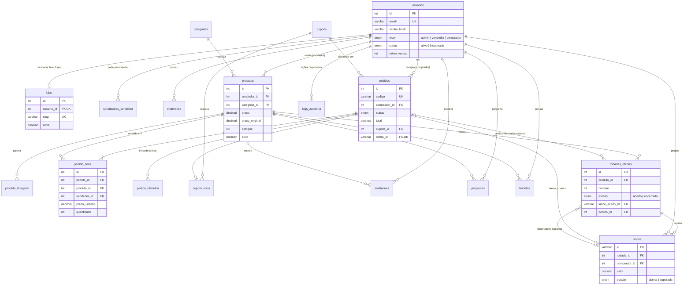

# Banco de dados — Âmbar Ofertas

MySQL 8 com InnoDB (transações e chaves estrangeiras). A estrutura original possui 19 tabelas; a migração de ofertas acrescenta duas, totalizando 21 tabelas na versão atual. Os scripts ficam em `sql/`:

| Arquivo | Conteúdo |
| --- | --- |
| `01_estrutura.sql` | Recria o banco `ambar_marketplace` com as 19 tabelas originais, chaves e restrições. |
| `02_dados_demo.sql` | Dados de demonstração: contas, lojas, produtos, pedidos, avaliações e perguntas. |
| `03_ofertas.sql` | Acrescenta rodadas e lances, adapta os pedidos e remove o preço fixo dos produtos. |

Para uma instalação nova com dados demonstrativos, execute `npm run db:criar` na raiz, após configurar `backend/.env`. O script aplica os três arquivos em ordem. Para atualizar uma instalação antiga de preço fixo, faça backup e utilize `npm run db:migrar`, conforme o README.

Executados manualmente, os SQLs utilizam o nome `ambar_marketplace`. O arquivo `01_estrutura.sql` apaga e recria esse banco; não o execute sobre dados que deseja preservar. A migração `03_ofertas.sql` deve ser aplicada uma única vez sobre a estrutura original.

## Diagrama entidade-relacionamento

O diagrama resume os relacionamentos principais e os campos centrais do fluxo de ofertas. A lista de tabelas abaixo inclui também recursos auxiliares; a definição completa de campos e restrições está nos scripts SQL.

## Tabelas

| Tabela | Papel | Destaques |
| --- | --- | --- |
| `usuarios` | Contas de todos os perfis | `email` único, `senha_hash` (bcrypt), `nivel`, `status`, contador de tentativas e `token_versao` para revogar JWT. |
| `lojas` | Vitrine de cada vendedor | 1:1 com `usuarios` (`usuario_id` único); `ativa` suspende a loja inteira. |
| `solicitacoes_vendedor` | Pedidos para virar lojista | Status `pendente`, `aprovada` ou `recusada`, com quem avaliou e quando. |
| `enderecos` | Endereços de entrega | CEP validado por `CHECK`; `ON DELETE CASCADE` com o usuário. |
| `categorias` | Organização do catálogo | `slug` único para URLs amigáveis. |
| `produtos` | Itens à venda | `preco` e `preco_original` nulos no modelo atual, protegidos por CHECK; estoque, exclusão lógica (`ativo`), média de avaliações e total vendido. |
| `produto_imagens` | Galeria | Várias fotos por produto, em ordem. |
| `cupons` | Descontos | Percentual (até 90%) ou valor fixo, mínimo do pedido, teto, limite de usos, período e regra de primeira compra. |
| `pedidos` | Negociações e compras históricas | Código único, valores registrados no pedido, status e `oferta_id` opcional e único. Pedidos históricos não possuem oferta vinculada. |
| `pedido_itens` | Itens de cada pedido | Nome, imagem e preço do momento da compra; `UNIQUE (pedido_id, produto_id)`. |
| `pedido_historico` | Linha do tempo | Um registro por mudança de status. |
| `cupom_usos` | Uso de cupons | Garante "um uso por cliente" e permite devolver o uso ao cancelar. |
| `avaliacoes` | Notas de 1 a 5 | Uma por cliente e produto (`UNIQUE`), com moderação (`visivel`). |
| `perguntas` | Perguntas e respostas | Respondidas pelo vendedor do produto. |
| `favoritos` | Lista de desejos | Relação N:N com chave primária composta. |
| `banners` | Carrossel da página inicial | Imagem e vídeo opcionais. |
| `configuracoes` | Regras ajustáveis | Frete grátis, desconto do Pix, parcelas e avisos do topo. |
| `newsletter` | Inscrições | E-mail único. |
| `logs_auditoria` | Rastreabilidade | Quem fez o quê, quando e de qual IP (com detalhes em JSON). |
| `rodadas_ofertas` | Rodadas de negociação por produto | `UNIQUE (produto_id, numero)`; referências ao produto, lance aceito e pedido; estado aberto ou encerrado. |
| `lances` | Propostas dos compradores | Referências à rodada e ao comprador; valor positivo em DECIMAL; estado aberta ou superada. |

## Decisões de modelagem

- **Dinheiro em `DECIMAL`**: nunca `FLOAT`. A API soma em centavos (inteiros).
- **Exclusão lógica de produtos**: apagar de verdade quebraria as chaves estrangeiras de pedidos antigos.
- **Fotografia da venda**: `pedido_itens` guarda nome, imagem e preço; editar o produto depois não muda o histórico.
- **Endereço copiado para o pedido**: mudar o cadastro não altera para onde o pedido foi enviado.
- **`TIMESTAMP` em UTC**: datas consistentes entre o MySQL, a API e o navegador.
- **Restrições `CHECK`**: o banco exige valor positivo para lances, impede preço fixo nos produtos da versão atual e valida outras regras, como nota de 1 a 5 e formato do CEP.

## Atualização: modelo de ofertas

A versão atual acrescenta `rodadas_ofertas` e `lances`, totalizando 21 tabelas. Cada produto pode ter várias rodadas; cada rodada recebe lances de compradores. A rodada aceita no máximo uma oferta e aponta para o pedido gerado. O pedido contém `oferta_id` único e chaves estrangeiras para preservar a consistência.

O preço de produto deixa de ser fixo: `produtos.preco` e `preco_original` são nulos e protegidos por CHECK. O valor acordado é copiado de `lances.valor` para o pedido e seu item na aceitação. Produto e rodada são bloqueados com `SELECT ... FOR UPDATE` durante a disputa transacional. A migração está em `sql/03_ofertas.sql`.

Os pedidos históricos de preço fixo são preservados com `oferta_id IS NULL`; a interface atual mostra as negociações com `oferta_id IS NOT NULL`. A evolução de status continua sendo registrada em `pedido_historico`.

## Integridade do modelo de ofertas

- `lances.rodada_id` referencia `rodadas_ofertas.id` e `lances.comprador_id` referencia `usuarios.id`.
- `rodadas_ofertas.produto_id` referencia `produtos.id`.
- `rodadas_ofertas.lance_aceito_id` referencia `lances.id`; o campo é nulo enquanto não houver aceite.
- `rodadas_ofertas.pedido_id` referencia `pedidos.id`; o campo é opcional.
- `pedidos.oferta_id` referencia `lances.id` e possui UNIQUE, impedindo dois pedidos com a mesma oferta não nula.
- A combinação de produto e número da rodada é única.
- O CHECK de `lances.valor` exige valor maior que zero.
- Os campos de preço do produto permanecem nulos por restrição CHECK.

O controle de qual lance pertence à rodada aceita e a sequência de aceitação, reserva de estoque e criação do pedido também dependem das regras e transações da aplicação em `backend/services/ofertas.js`. As chaves estrangeiras, isoladamente, não validam todas essas regras.
